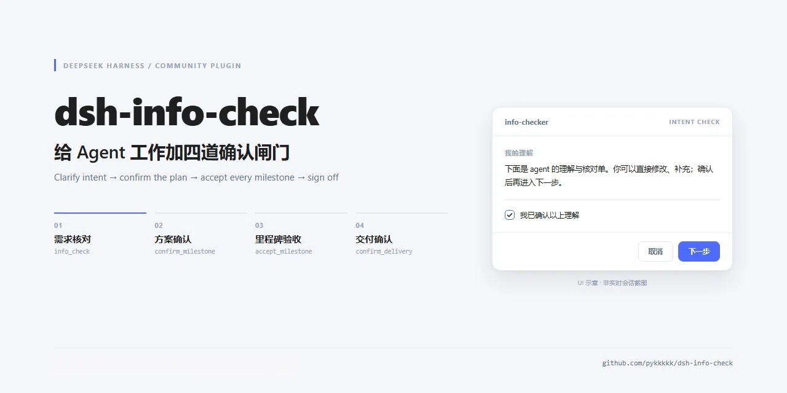
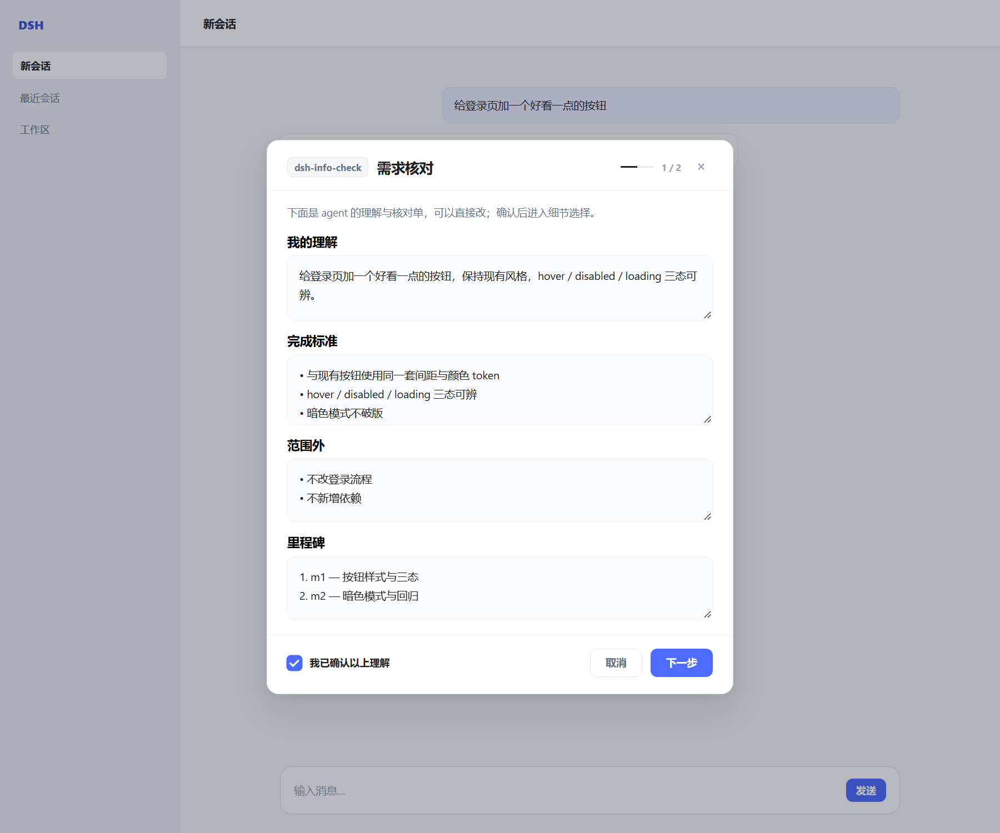
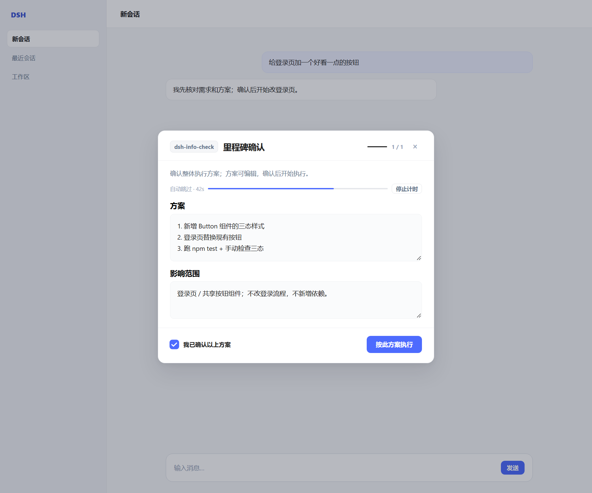
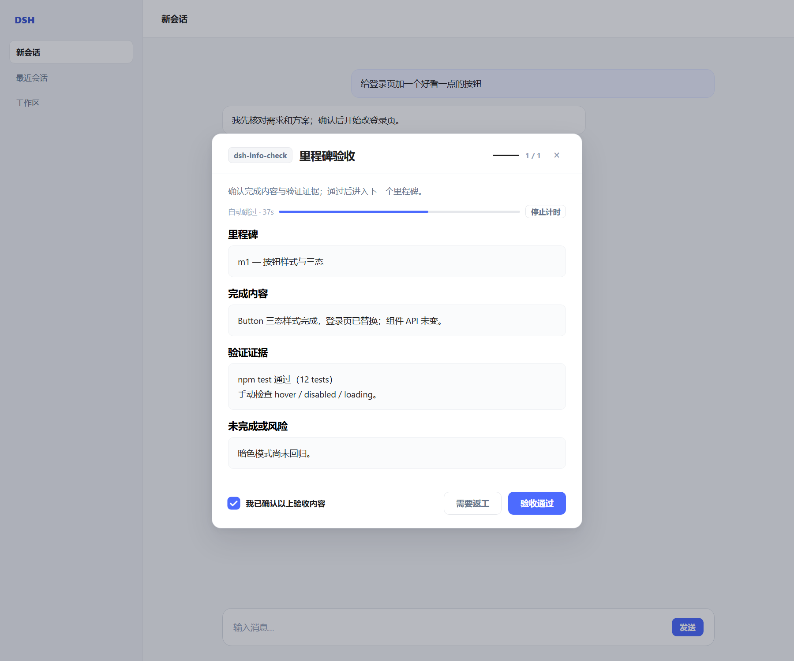
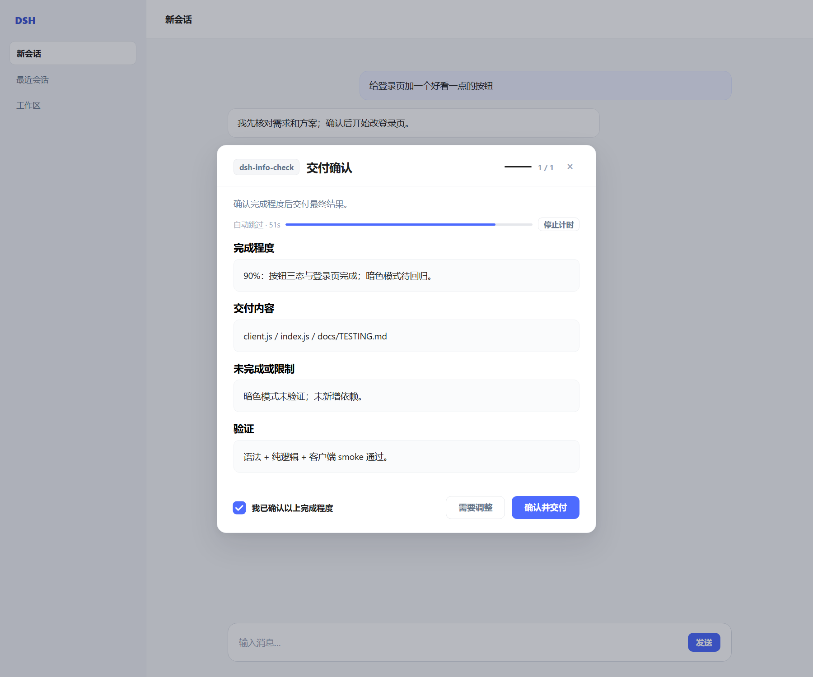
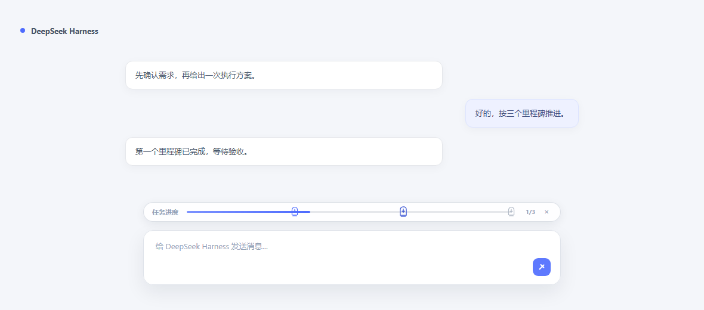
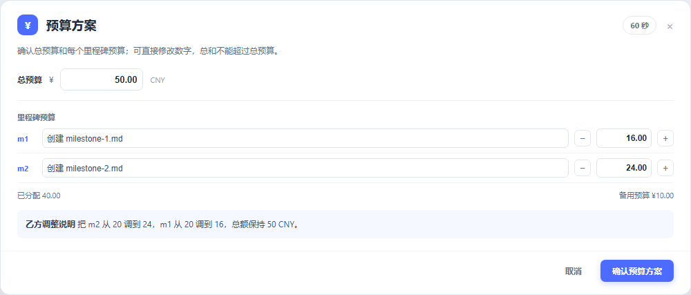
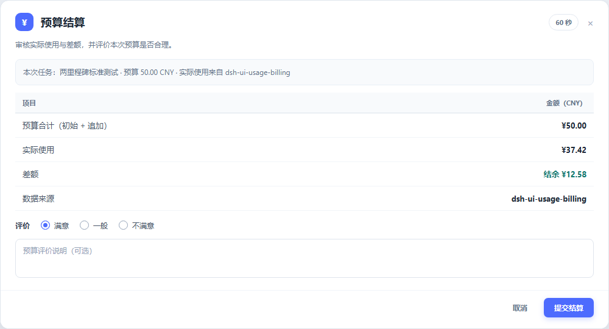
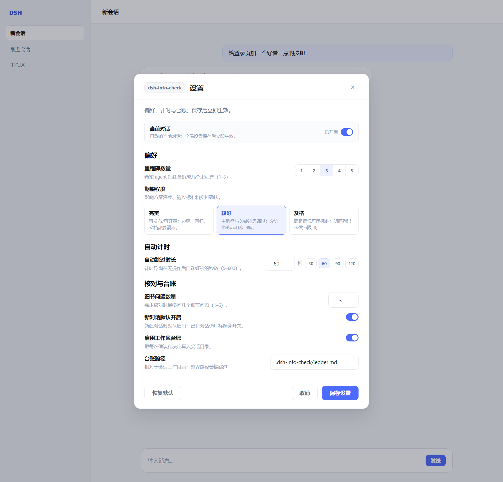

<h1> dsh-info-check</h1>

[](https://github.com/pykkkkk/dsh-info-check/releases)
[](https://github.com/deepseek-ai/deepseek-harness)
[](LICENSE)



English | [中文](README.md)

Agents often start executing immediately. Misunderstandings then surface only at delivery, when rework is most expensive.

dsh-info-check adds four confirmation points to the workflow, so you can review the report at each key step before deciding whether to continue.

## Task archive page

After the budget plan is confirmed, the sidebar gains a **Task archive** entry. Each task appears as a collapsible item; click it to expand:

- project objective;
- quality requirements;
- scope boundaries;
- milestone budget table;
- acceptance and change terms;
- acceptance reports with each milestone's completion, delivered files, evidence, and gaps/risks;
- budget review records and a final settlement financial table (initial budget, extra, total, actual usage, variance, rating);
- ledger timeline;
- whether the budget is signed and the last update time;
- task number in `YYMMDDHHmm` (10 digits), e.g. `2601010100` means 2026-01-01 01:00.

The header shows total tasks, signed, settled, and total budget, with search by task title, task number, or task-book content. Items are sorted by latest update; each task is stored separately and does not overwrite older tasks. The page refreshes every four seconds.

The task archive has three tabs:

- **Ledger**: the task list, contracts, acceptance records, and settlements above;
- **Quality standard**: reads and edits `.dsh-info-check/quality-standard.md`;
- **Budget standard**: reads and edits `.dsh-info-check/budget-standard.md`.

Reload reads the local file; Save locally writes it back to the same Markdown file. Generated statistics may refresh after retrospective/settlement; the manual section is preserved.

## Budget forecast and live chart

After the task book is confirmed, call `forecast_budget` to estimate tokens with the current model's CNY token prices, then pass the returned forecast to `confirm_budget`. Round 1 without a forecast is rejected. The budget card shows the model, input/output tokens, estimated CNY, confidence band, and assumptions.

The rule, coefficients, and references are in [docs/PREDICTION.md](docs/PREDICTION.md). Actual spending still comes from usage-billing.

After sign-off, a floating right-side budget panel appears:

- the line shows cumulative actual usage after the task starts, measured from the whole-session cost baseline captured at budget sign-off;
- the Y axis is CNY;
- each milestone's cumulative budget is a red dashed threshold;
- it refreshes every three seconds from billing, falling back to token estimation.

## Situation alignment card

`dsh-info-check` exposes a generic `situation_check` tool that any plugin or skill can call when it is unsure during execution:

- **Current question**: read-only;
- **Agent suggestions**: one or more selectable options;
- **User opinion**: free-form input.

The card uses the existing `PanelShell` and button components and supports a countdown. If the user does not answer, closes the card, or it times out, the tool returns `timeout/cancelled` and the agent continues with its own understanding. Every choice or opinion is written to the task ledger timeline and shown in the Task archive.

## Desktop reminders

On Windows, a system notification appears in the bottom-right corner when a plugin confirmation card opens:

- task book confirmation;
- budget plan confirmation/sign-off;
- milestone acceptance;
- budget review;
- delivery confirmation;
- budget settlement rating;
- optional retrospective prompt.

It follows the same approach as `dsh-ui-usage-billing`: the Host records dialog events, the Client polls them, and calls the browser `Notification` API. The first time, click **Enable desktop notifications** in the bottom-right corner and allow notifications for the site. No BurntToast or PowerShell tray process is needed.

If the site permission is denied, system notifications are off, or Focus Assist is on, Windows may suppress the notification.

## Task progress

A progress bar appears just above the message box. Each milestone is a line-drawn stone tablet: progress moves forward faster, stops near the next tablet while it waits for acceptance, reaches the tablet when you accept, and finishes at the end after delivery, then hides. It reappears when the next task confirms its plan.

Hover a tablet to see the milestone title. Progress is saved per conversation and survives switching, refreshing, or restoring the session. The milestone list is locked after plan confirmation and cannot grow or shrink before the task ends. When the task is over, use the × on the progress bar or run `/dsh-info-check reset` to clear it.

## Screenshots

| Intent check | Plan confirmation |
|---|---|
| [](docs/screenshots/01-intent-check.png) | [](docs/screenshots/02-plan-confirmation.png) |
| **Milestone acceptance** | **Delivery confirmation** |
| [](docs/screenshots/03-milestone-acceptance.png) | [](docs/screenshots/04-delivery-confirmation.png) |

**Task progress**

[](docs/screenshots/08-progress-bar.png)

**Budget plan**

[](docs/screenshots/10-budget-plan.png)

**Budget settlement**

[](docs/screenshots/09-budget-settlement.png)

**Settings**

[](docs/screenshots/07-settings.png)

## Install

Install it from the **Plugins** page in DSH:

```text
dsh-info-check
```

Or use npm:

```sh
npm install dsh-info-check@0.3.0
```

Refresh the page after installing. A small underlined **需求核对** switch will appear next to the agent preset.

Built for DSH `0.2.x`; currently tested with `0.2.2-rc.5`.

## Check after install

From the plugin install directory, run:

```sh
node scripts/minimal-test.mjs
```

It checks package.json, entry files, the bundle, and the client loader id in a few seconds. For the fuller offline check:

```sh
node scripts/self-check.mjs
```

## Project workflow

Each task is handled like a small engineering contract:

1. **Task book**: the agent restates the goal, quality bar, out-of-scope items, and milestones; the user reviews and edits it.
2. **Budget plan**: right after the task book, the budget plan card shows a total budget in CNY and a budget for each milestone; the user edits both directly, the milestone label is fixed (`m1`, `m2`), the content input holds only the milestone text, the sum cannot exceed the total, and the remainder is the reserve.
3. **Two rounds**: after the first confirmation, the agent rethinks and explains its adjustments; the second confirmation signs the budget and locks the milestones.
4. **Execution and acceptance**: finish one milestone, then accept that milestone.
5. **Budget review**: a text display box plus a numeric display; whether to add budget is a choice inside the card, and the amount input appears only after choosing to add.
6. **Delivery and settlement**: confirm delivery, then rate the budget in a financial-report table; the ledger feeds the quality and budget standards.

See **[docs/FLOW.md](docs/FLOW.md)** for the full flowchart and stage table.

## What it adds

### A moment to align on the goal

Before substantive work, the agent restates what it understands, asks a few questions that actually affect the result, and lists the quality bar, out-of-scope items, and milestones.

You can edit that checklist directly and add your own requirements.

### One plan confirmation

Once the goal is clear, the agent proposes a plan. You confirm it once, so the work does not keep stopping for the same decision.

The milestone section shows which step you are on and what it covers.

### Acceptance after every milestone

After each milestone, the agent reports what was completed, how it was verified, and what is still open.

The report is read-only. You can:

- **Accept** and move to the next milestone;
- **Request rework**, add a reason, and let the agent revise it;
- **Pause the task**, so the agent summarizes the current progress and stops.

### A final sign-off before delivery

Before the final result, the agent explains how complete it is, what it delivers, what is limited, and how it was verified. Nothing is delivered until you confirm.

## Working with the cards

- Every point has its own box and number; long text makes the box grow.
- Every confirmation ends with a free-form **Notes** field.
- Drag the right edge to widen a dialog; double-click to reset it.
- The three timed cards have a countdown and a **Stop timer** button.
- Options can be clicked again to clear them, and each question has an **Other** field for your own answer.
- Acceptance reports can list result files; click a path to open its location.
- The top-right **X** means skip: continue with the agent's version without interrupting the task.

## Switch and settings

The **需求核对** switch next to the title only affects the current conversation.

Click the underlined words to open settings, where you can change:

- the number of milestones;
- the expectation level: perfect, good, or pass;
- the auto-skip timeout;
- how many detail questions the agent asks;
- whether new conversations start with the plugin on;
- whether to keep a ledger, and where to put it;
- whether retrospectives run automatically;
- supervision mode: strict checks or advisory;
- quality standard: enter your own requirements, saved into `.dsh-info-check/quality-standard.md`;
- file locations: open the ledger, retrospective, quality standard, or budget standard directly.

Changes take effect immediately; no restart is needed.

Useful commands:

```text
/dsh-info-check on
/dsh-info-check off
/dsh-info-check status
/dsh-info-check retrospective
/dsh-info-check quality
/dsh-info-check quality rebuild
```

## Retrospectives and quality standard

After each confirmed delivery, the plugin summarizes the task's acceptance results, rework and adjustment reasons, and your notes into one retrospective file: `.dsh-info-check/retrospectives.md`, and returns a short retrospective summary with the delivery. Acceptance events are persisted so a plugin reload does not lose the current task's review.

Retrospectives run automatically by default. If you turn off **Auto retrospective** in settings, the plugin asks whether to add the task to the retrospective when you confirm delivery.

Every three completed tasks, the plugin updates `.dsh-info-check/quality-standard.md` from the accumulated retrospectives. That standard is included in later task instructions so the agent can follow your acceptance habits more closely. The manual section is preserved, and the standard is length-limited.

Budget settlements also accumulate into `.dsh-info-check/budget-standard.md`, updated every three settlements for later quotes; the manual section is preserved.

Retrospectives and the quality standard stay in the current workspace; nothing is uploaded or sent over the network.

## Privacy

- No network calls, telemetry, analytics, or remote fonts.
- Your choices are written to `.dsh-info-check/ledger.md` in the current session directory; retrospectives and the quality standard stay in the current workspace too.
- Retrospectives include your feedback and notes, but only for later local tasks; nothing is uploaded.
- It is a tool for keeping the process visible, not a security boundary; turning it off or skipping a card does not forcibly block the agent.

## License

MIT. Copyright (c) 2026 pykkkkk (Wenhao Liu). See [LICENSE](LICENSE).
