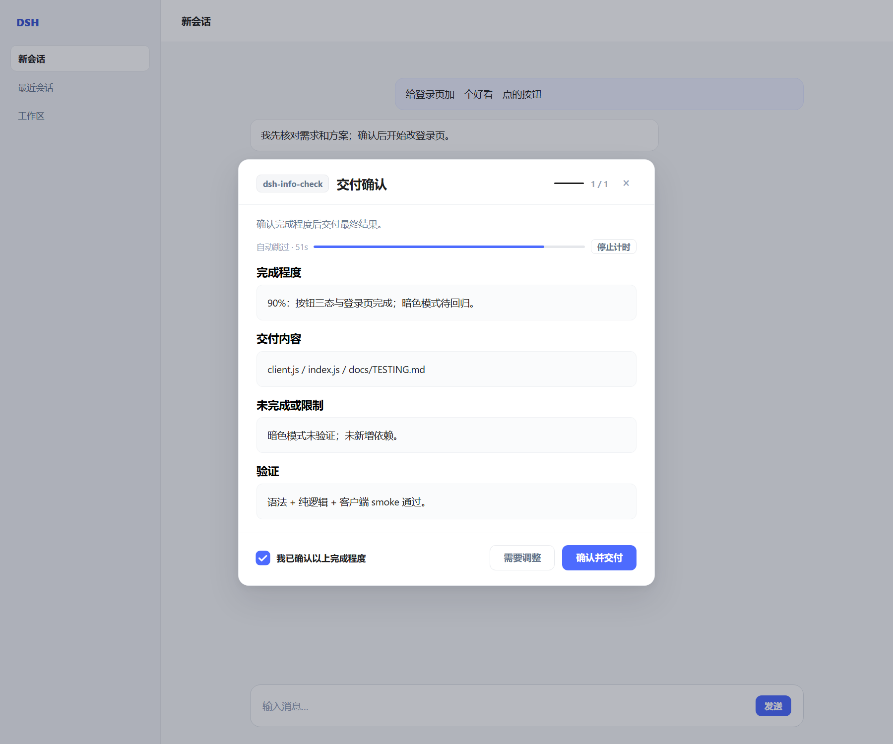

<h1> dsh-info-check</h1>

[](https://github.com/pykkkkk/dsh-info-check/releases)
[](https://github.com/deepseek-ai/deepseek-harness)
[](LICENSE)


[English](README.en.md) | 中文

Agent 接到任务后直接进入执行，理解偏差往往到交付时才暴露，返工成本随流程推进上升。

dsh-info-check 的做法是在流程中插入四个确认点，让用户在关键节点看完报告再决定是否继续。

## 任务进度

输入框上方会出现一条任务进度条。每个里程碑是一块线描石碑；进度会慢慢向前走，接近石碑时停下来等你验收，验收时快速到达石碑，交付后走到终点。

进度按会话保存，切换对话、刷新或恢复会话后仍会保留。

## 界面预览

| 需求核对 | 方案确认 |
|---|---|
| [](docs/screenshots/01-intent-check.png) | [](docs/screenshots/02-plan-confirmation.png) |
| **里程碑验收** | **交付确认** |
| [](docs/screenshots/03-milestone-acceptance.png) | [](docs/screenshots/04-delivery-confirmation.png) |

**设置**

[](docs/screenshots/07-settings.png)

## 安装

在 DSH 的 **插件** 页面安装：

```text
dsh-info-check
```

也可以使用 npm：

```sh
npm install dsh-info-check@0.2.2
```

安装后刷新页面。标题旁会出现一个带下划线的 **需求核对** 开关。

适用于 DSH `0.2.x`，当前验证版本为 `0.2.2-rc.3`。

## 它会在什么时候出现

### 先对齐需求

开始实质工作前，agent 会先复述它理解的目标，列出几个真正影响结果的问题，并给出完成标准、范围外和里程碑。

你可以直接修改这份核对单，也可以补充自己的要求。

### 确认一次方案

需求明确后，agent 会给出执行方案。方案只确认一次，之后不会反复打断你。

里程碑一栏会直接写明当前是哪一步、主要做什么。

### 每个里程碑完成后验收

每完成一个阶段，agent 会提交完成内容、验证证据和剩余风险。

报告是只读的，你不需要改报告本身。你可以：

- **验收通过**，继续下一阶段；
- **需要返工**，写下理由，让 agent 修改后重新验收；
- **暂停任务**，让 agent 整理当前进度并结束这次工作。

### 交付前再确认一次

最终结果出来前，agent 会再说明完成程度、交付内容、限制和验证。你确认后再交付。

## 使用时的细节

- 每个要点都有自己的文本框和序号，长文本会自动撑开。
- 每张确认卡末尾都有 **备注**，可以写额外要求。
- 浮窗可以从右边缘拉宽，双击复位。
- 三张计时卡都有倒计时和 **停止计时**；不想等时可以手动停。
- 选项可以再次点击取消；每个选项题下方都能自己输入“其他”。
- 验收时可以附上结果文件路径，点击直接打开文件所在位置。
- 右上角的 **X** 表示跳过：按 agent 的版本继续，不会中断整个任务。

## 开关和设置

标题旁的 **需求核对** 开关只影响当前对话。

点击下划线文字可以打开设置，调整：

- 里程碑数量；
- 期望程度：完美 / 较好 / 及格；
- 自动计时秒数；
- 细节问题数量；
- 新对话默认是否开启；
- 是否记录台账，以及台账路径；
- 是否自动复盘。

改动会立即生效，不需要重启。

常用命令：

```text
/dsh-info-check on
/dsh-info-check off
/dsh-info-check status
/dsh-info-check retrospective
/dsh-info-check quality
/dsh-info-check quality rebuild
```

## 任务复盘与质量标准

每次确认交付后，插件会把本次任务的验收结果、返工和交付调整原因、用户备注整理成一份复盘，追加到同一个 `.dsh-info-check/retrospectives.md`。

默认自动复盘。在设置里关闭“自动复盘”后，交付时会询问你是否将本次工作加入复盘。

每完成 3 次任务，插件会根据累计复盘更新 `.dsh-info-check/quality-standard.md`。这份标准会进入后续任务的提示中，让 agent 更贴近你的验收习惯；标准里的“手工补充”区域会保留你的修改，并限制整体长度。

复盘和质量标准都只保存在当前工作区，不会联网或上传。

## 隐私

- 不联网，没有遥测、统计或远程字体。
- 你的选择会记录在当前会话目录的 `.dsh-info-check/ledger.md`；复盘和用户工作质量标准也只保存在当前工作区。
- 复盘会包含你的反馈和备注；这些内容只用于本地后续任务，不会上传。
- 它是一个帮助你看清过程的工具，不是安全边界；关闭或跳过时不会强行阻止 agent 工作。

## 许可证

MIT。Copyright (c) 2026 pykkkkk (Wenhao Liu)。见 [LICENSE](LICENSE)。
