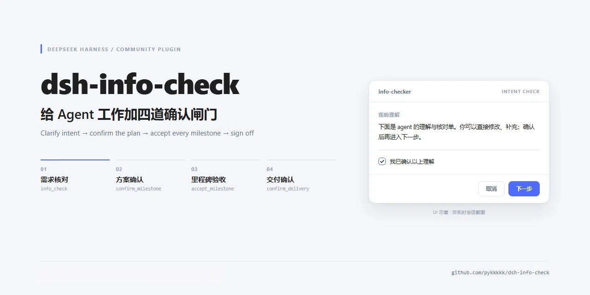
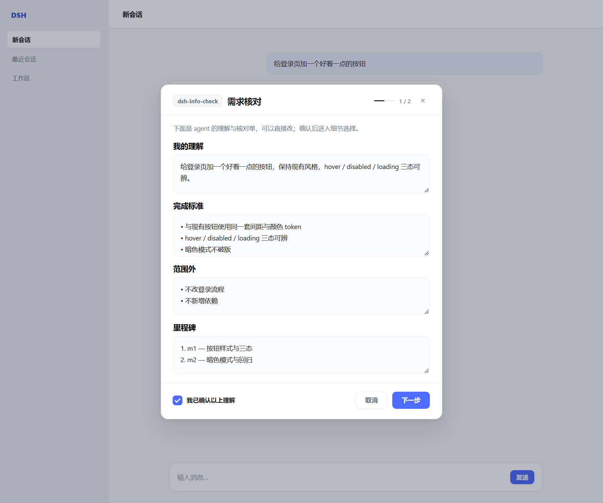
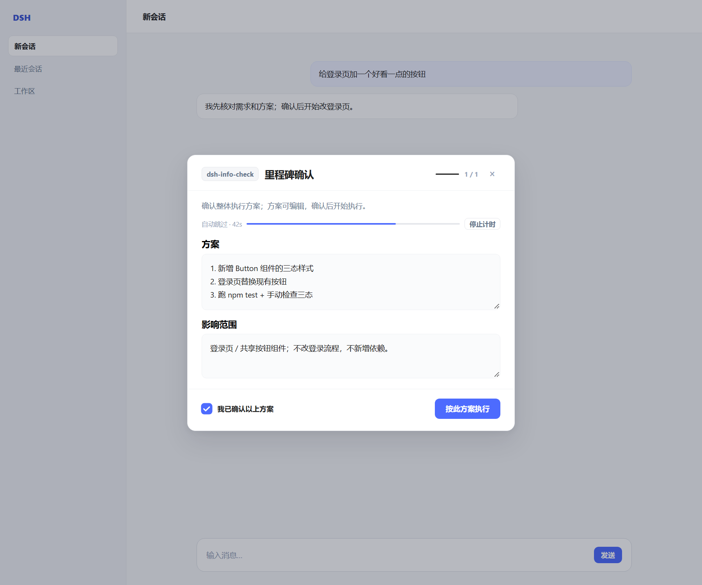
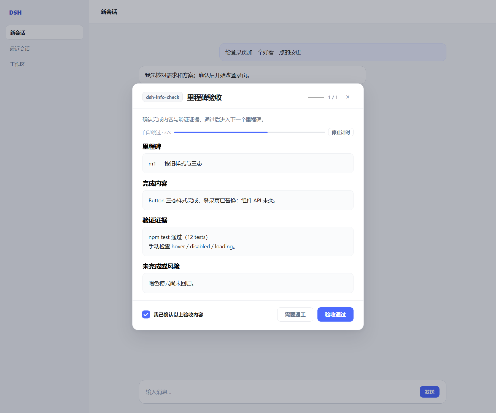
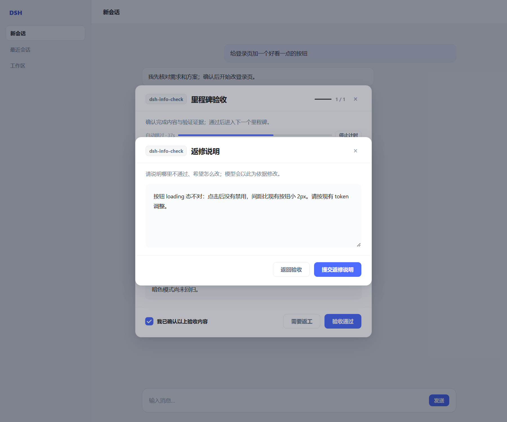
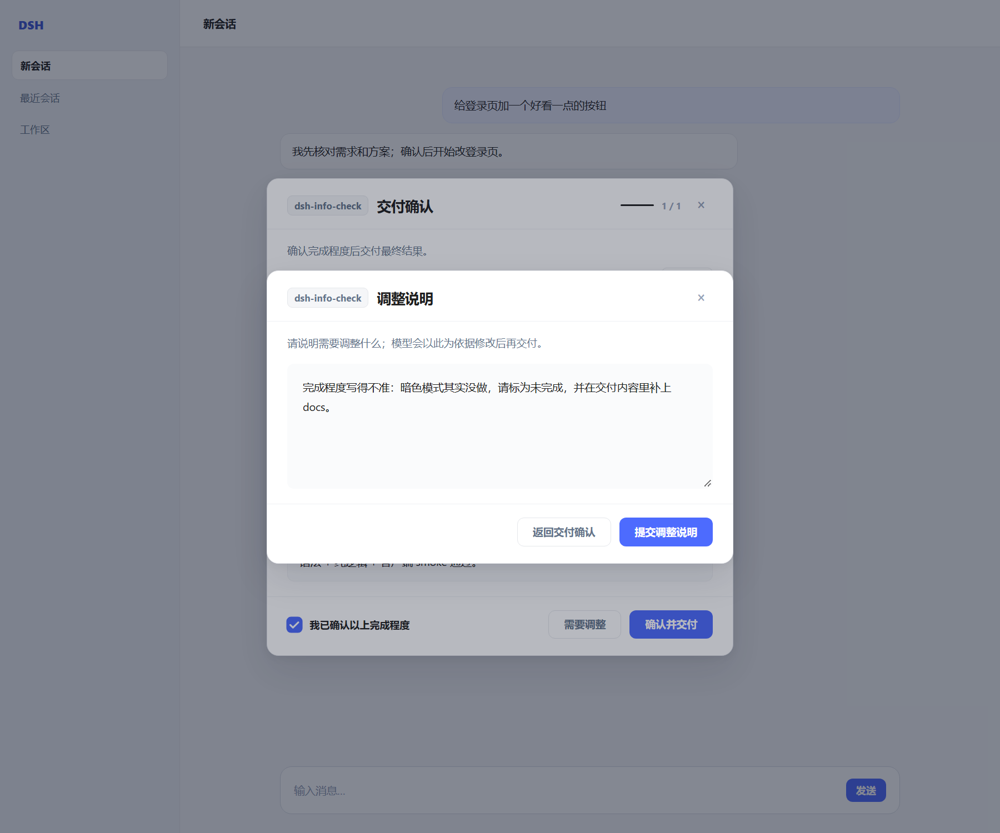

# dsh-info-check



English | [中文](README.zh.md)

Repository: <https://github.com/pykkkkk/dsh-info-check>

A [DeepSeek Harness](https://github.com/deepseek-ai/deepseek-harness) bundle that puts **confirmation gates** around agent work: clarify intent first, confirm the plan once, accept every milestone, and sign off before the final result.

> 中文简介：给 DSH 加一道“需求核对 → 方案确认 → 里程碑验收 → 交付确认”的闸门；每个对话独立开关，确认过程和选择会写入工作区台账。

## Status

Tested against **DSH `0.2.2-rc.3`** (Desktop profile, Windows). DSH plugin slots and services are still evolving; the bundle targets the `0.2.x` API family and may need small updates for later releases.

This is an independent community bundle, not an official DeepSeek package.

## What it adds

| Gate | Tool | When |
|---|---|---|
| Intent check | `info_check` | Before substantive work: restate the goal, ask 2–3 detail questions, agree on quality bar / out of scope / milestones |
| Plan confirmation | `confirm_milestone` | **Once** after the intent check: confirm the execution plan (first milestone) |
| Milestone acceptance | `accept_milestone` | After **every** milestone: read-only completion report; accept or request rework with notes |
| Delivery sign-off | `confirm_delivery` | Before the final result: read-only completion level; confirm or request adjustments |

Every confirmation is a centered floating window with a read-only or editable report, a confirm checkbox, a primary action, and — for the three timed gates — a countdown (60 seconds by default) with a **Stop timer** button. “Needs rework / Needs adjustment” opens a second floating window for the reason; that reason goes back to the model as `feedback`.

Dialogs are **resizable from the right edge**; the maximum width equals the dialog height (and stays within 75% of the viewport). Every point has its own box with a separate number badge (`1`, `2`, `3` …), and every confirmation ends with a free-form **Notes** field.

Detailed design and flow notes (Chinese): [docs/DETAIL.md](docs/DETAIL.md). UI notes: [docs/UI.md](docs/UI.md).

## Screenshots

Rendered from the plugin's actual dialog styles against a neutral mock chat background. They are UI previews, not captures of a specific live session. The interface is shown in Chinese; the English strings ship in the same bundle.

**Social preview source:** [docs/social-preview.png](docs/social-preview.png) (1280×640, under 1 MB).

| Intent check — editable brief | Plan confirmation — once |
|---|---|
| [](docs/screenshots/01-intent-check.png) | [](docs/screenshots/02-plan-confirmation.png) |
| **Milestone acceptance — read-only report** | **Delivery confirmation — read-only report** |
| [](docs/screenshots/03-milestone-acceptance.png) | [](docs/screenshots/04-delivery-confirmation.png) |
| **Rework notes — opened by “Needs rework”** | **Adjustment notes — opened by “Needs adjustment”** |
| [](docs/screenshots/05-rework-notes.png) | [](docs/screenshots/06-adjustment-notes.png) |

**Settings** — preferences, auto-timer, review/ledger, and the current conversation:

[](docs/screenshots/07-settings.png)

## Flow

```
intent check -> plan confirmation (once) -> milestone 1
  -> acceptance 1 -> milestone 2 -> acceptance 2 -> ...
  -> delivery confirmation -> final result
```

## Install

This is a local DSH bundle (a directory with `dsh.bundle.patch`). It is not published to npm.

1. Clone/copy this directory to the machine running DSH.
2. Open **Plugins** in DSH, choose **Add plugin**, and point at this directory.  
   Or, with plugin-manager access:

   ```text
   plugin_manager install_bundle target=<absolute path to this directory>
   ```

3. The bundle adds one Host row (`include:dsh-info-check`). The client half loads on the next page refresh.

Requirements:

- DSH `0.2.x` (tested with `0.2.2-rc.3`).
- The Host process must provide `tools`, `systemPrompt`, `userQuestions`, `workingDirectory`, `sessionProjections`, and `commands`.
- The Web client must provide `react-dom`'s `createPortal` and the `remote.settings` namespace; without the portal the dialogs fall back to in-composer cards.

## The switch

A small **需求核对** switch sits next to the **创造模式** (agent preset) chip:

- New-session row: in `conversation.hero.options`, right of the preset control.
- Inside a session: in `conversation.session.header.actions`, immediately after the preset label.

Clicking the underlined words opens the plugin's settings window. Clicking the switch toggles the gate **for the current conversation only**. State is written as a logged `/dsh-info-check on|off` command and folded by a session projection, so fork/resume keeps the same choice.

Useful command:

```text
/dsh-info-check status
/dsh-info-check on
/dsh-info-check off
```

## Settings

Click the underlined **需求核对** words next to the switch to open the plugin's settings window. It edits the global Config and saves immediately; the current-conversation switch inside the window only changes this session.

- **Preferences** — number of milestones (1–5) and expectation level: 完美 / 较好 / 及格. These feed the policy, acceptance evidence, and delivery sign-off.
- **Auto-timer** — auto-skip seconds (5–600; presets 30/60/90/120).
- **Review and ledger** — detail-question count (1–6), new-conversation default, ledger on/off, and ledger path.
- **This conversation** — turn the gate on or off for the current session without leaving Settings.

The values are volatile Config fields, so a save takes effect without restarting the plugin.

## Timers and notes

- Timed gates count down `timeoutSeconds` (default 60); timeout proceeds (acceptance passes / delivery proceeds).
- **Stop timer** freezes the countdown and keeps the dialog open.
- Opening a “rework notes” / “adjustment notes” dialog also stops the timer.
- The acceptance and delivery reports are **read-only**; the user's input is the reason, not a rewrite of the report.

## Ledger

Every decision is appended to:

```text
<session working directory>/.dsh-info-check/ledger.md
```

It records the agent's report, the user's decision, edited plans, and rework notes. Writes are confined to the session directory; a path that escapes it is skipped. `ledgerEnabled` / `ledgerPath` change this behavior.

## Configuration

The bundle uses a small **Config schema** (loaded from the DSH-provided schemastery, so the package still has no runtime npm dependencies). All fields are volatile and are normally edited from **Settings** rather than the patch file:

| Field | Default | Meaning |
|---|---|---|
| `milestoneCount` | `3` | Preferred number of milestones (1–5) |
| `expectation` | `good` | `perfect` / `good` / `pass`; feeds the policy and acceptance standard |
| `timeoutSeconds` | `60` | Countdown for plan/acceptance/delivery gates (5–600) |
| `maxQuestions` | `3` | Intent-check detail questions (1–6) |
| `defaultEnabled` | `true` | Default for sessions with no `/dsh-info-check` command yet |
| `ledgerEnabled` | `true` | Append decisions to the workspace ledger |
| `ledgerPath` | `.dsh-info-check/ledger.md` | Ledger path, relative to the session directory |

## Privacy

- No network calls, telemetry, analytics, or remote fonts.
- The only file writes are the ledger under the session directory.
- The user's choices are also present in the session log (commands and tool results).
- This is a UX gate, not a security boundary: it does not hard-block file writes when disabled or unconfirmed.

## Portability and renaming

The working copy uses the local package name `@local/dsh-info-check` (`private: true`). To publish under your own scope/name, change these together:

1. `package.json` `name`.
2. `client.js` `__ModuleLoader__.load({ id: ... })`.
3. `cordis.patch.yml` row `name`.
4. Any profile package/bundle references, then reinstall.

The client also relies on DSH-specific slot names (`conversation.composer`, `conversation.hero.options`, `conversation.session.header.actions`) and the `useProjection` / `remote.commands` client services. Keep the tested DSH version pinned by `engines.dsh`.

The per-session switch uses a tiny `{ parse }` schema for its `infoCheck` projection (so the bundle stays dependency-free). It is validated against DSH `0.2.2-rc.3`; if a later release requires a full schema library, add one and bump `engines.dsh`.

## Limitations

- Root sessions only; subagents cannot ask the user.
- Each toggle leaves one `/dsh-info-check` command line in that conversation.
- The dialogs use the DeepSeek Blue light palette; dark-mode adaptation is not included.
- The new-session switch lives in the hero row; after the first message the header switch takes over.
- Countdown behavior depends on the shipped question-card implementation; the countdown pauses while focused/edited.
- The ledger is plain Markdown and grows over time; rotate/archive it if needed.

## Development

No runtime install step is required (there are no runtime dependencies):

```sh
npm run check   # node --check on Host, client and pure helpers
npm test        # pure logic + client smoke tests
```

Project layout:

```text
index.js              Host plugin: policy, tools, projection, command, ledger
client.js             Browser plugin: dialogs, header/hero switch, settings window
lib/pure.js           Validation, section rendering, outcomes, ledger entries
test/                 Node-only tests (no DSH required)
locale/               Plugin-manager display metadata
docs/                 Detail page, UI notes, manual test plan, screenshots
cordis.patch.yml      Bundle patch row
icon.svg              Original icon
```

See [CONTRIBUTING.md](CONTRIBUTING.md) and [docs/TESTING.md](docs/TESTING.md). Before a release, run the fixed [manual regression checklist](docs/MANUAL-REGRESSION.md). The component browser E2E is documented in [docs/E2E.md](docs/E2E.md).

## License

MIT. Copyright (c) 2026 pykkkkk (Wenhao Liu). See [LICENSE](LICENSE).

Design baseline: DeepSeek Blue single-accent palette, restrained 8px radii, and read-first layouts. No third-party code or artwork is bundled; the icon is original.
