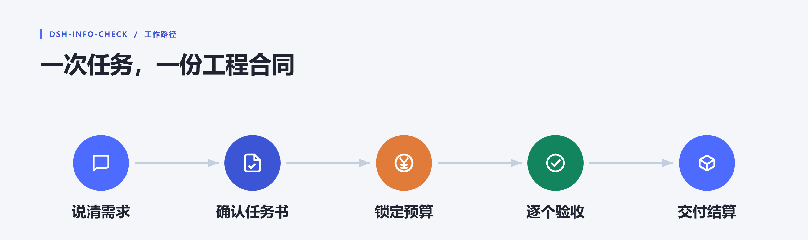
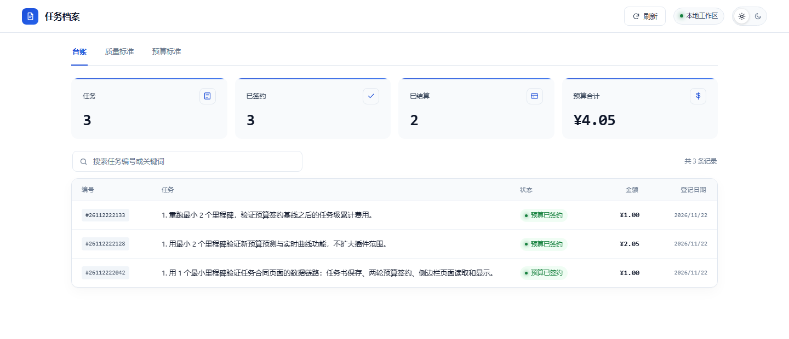
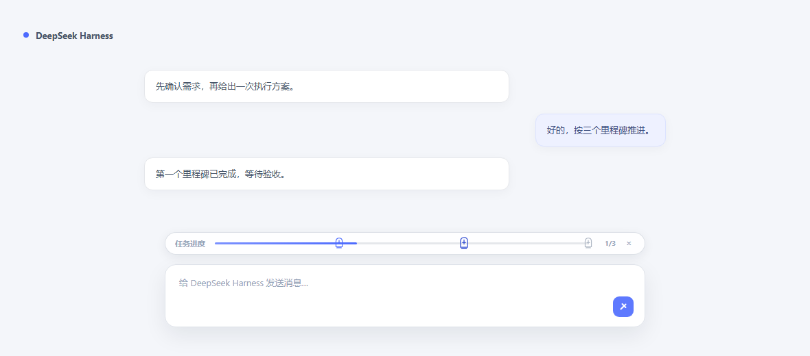
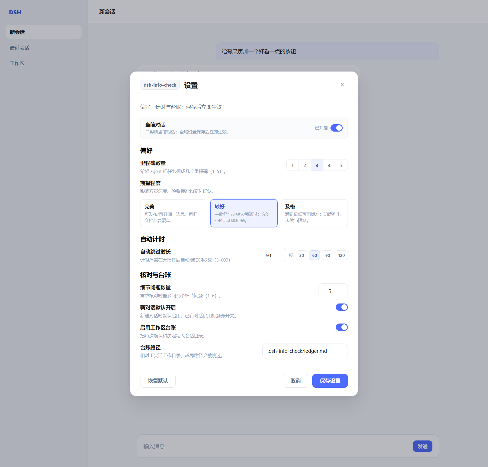

<h1> dsh-info-check</h1>

[](https://github.com/pykkkkk/dsh-info-check/releases)
[](https://github.com/deepseek-ai/deepseek-harness)
[](LICENSE)


[English](README.en.md) | 中文

[](docs/screenshots/flow-poster-simple.png)

Agent 接到任务后直接进入执行，理解偏差往往到交付时才暴露，返工成本随流程推进上升。

<strong style="color:#4D6BFE">dsh-info-check</strong>将 User 定位为“甲方”、Agent 定位为“乙方”，引入工程项目管理的思想，从质量和预算两方面管理 Agent 的任务执行情况。


## 任务档案页面



预算方案确认后，侧边栏会增加 **任务档案** 入口。页面把每个任务显示为一个可折叠条目，点击条目展开：

- 项目目标；
- 质量要求；
- 范围边界；
- 里程碑预算表；
- 验收与变更条款；
- 验收报告：每个里程碑的完成内容、交付文件、验证证据和未完成/风险；
- 预算审核记录和最终预算结算财务报表（初始预算、追加、合计、实际使用、差额、评价）；
- 台账时间线；
- 预算是否已签约和最近更新时间；
- 任务编号：`YYMMDDHHmm` 十位数字，例如 `2601010100` 表示 2026-01-01 01:00。

页面顶部有任务总数、已签约、已结算和预算合计，并支持按任务标题、任务编号或任务书内容搜索。列表按最近更新排序；每个任务独立保存，不会覆盖旧任务。页面每 4 秒自动刷新。

任务档案有三个标签页：

- **台账**：上面列出的任务列表、合同、验收和结算记录；
- **质量标准**：直接读取并编辑 `.dsh-info-check/quality-standard.md`；
- **预算标准**：直接读取并编辑 `.dsh-info-check/budget-standard.md`。

标准页的“重新加载”读取本地文件，“保存到本地”写回同一个 Markdown 文件。自动生成的统计区可能在复盘/结算后更新，手工补充区会保留。

## 预算预测与实时曲线

任务书确认后，先用 `forecast_budget` 按当前模型的人民币 token 单价预测预算，再把预测对象传给 `confirm_budget`。第一轮预算必须带预测，否则工具会拒绝；预算卡会显示模型、input/output token、预估金额、置信区间和假设。

预测规则、系数和参考研究见 [docs/PREDICTION.md](docs/PREDICTION.md)。预算不是凭感觉填的数字，实际费用仍以 usage-billing 的实时计量为准。

预算签约后，右侧会出现预算执行浮动面板：

- 折线显示任务开始后的累计实际使用，从预算签约时记录的整会话费用基线起算；
- 纵坐标按人民币；
- 每个里程碑的累计预算画成红色虚线阈值；
- 每 3 秒刷新，数据来自 billing 实际费用，失败时退回 token 估算。

右上角的 × 只收起面板，右侧会留下“预算”浮标；点击浮标重新展开，不会丢失累计数据。

## 审计 agent

设置里有一个可选的 **审计 agent** 开关，默认关闭。

开启后，在交付确认卡和预算结算卡生成之后、弹出之前，会启动一个独立审计子 agent：

- 读取当前任务的执行记录（思考、工具调用、工具结果）；
- 对照合同记录、验收、预算审核、情况对接记录；
- 核对卡片里的完成内容、交付内容、限制、实际使用和差额是否如实；
- 把 `faithful / issues` 结论追加到卡片中，并写入任务台账时间线。

审计是辅助门禁，不是替 agent 重做任务。审计子 agent 启动失败时会显示“未完成”警告，但不会静默放行。开启监理子 Agent 后，审计自动降为轻量复核，只检查关键完成项和数字是否与记录明显矛盾，避免与监理重复审查。

## 监理子 Agent

设置里有一个可选的 **监理子 Agent**，默认关闭。

开启后，每个里程碑调用 `accept_milestone` 时，会先启动独立监理子 agent，按已确认合同审查当前里程碑。同一对话复用同一个监理子 agent，保留前序里程碑的审查上下文，不会每检查一次就新开一个。

- 完成内容是否覆盖合同要求，是否超出范围；
- 验收证据是否真实、可复核；
- 是否遗漏未完成项、风险或限制；
- 边界条件是否如实声明；
- 不以合同之外的额外要求拒绝。

监理要求重大返工时不会弹出验收卡，只返回 `supervisor-rework` 和返工清单；主 agent 修改后重新提交。监理接受或小修处理后，验收卡才弹出，并附上监理结论。

监理信号分三档：

- `accept`：直接进入验收；
- `minor`：只需小修，主 agent 按清单修完即可再次验收，不再回传监理；
- `major`：重大返工，必须修改后重新提交监理。

开启监理时，审计（若也开启）只做轻量复核，并重点检查 `minor` 修改是否落实以及其他可能遗漏的细枝末节。

监理原则是公正、独立、自主：严格维护甲方，但只按合同判断，不过分苛求乙方。监理记录会写入任务档案的验收报告。

任务执行中如果关键边界（地区、范围、数据、验收口径、预算）需要变化，agent 必须先调用 `situation_check` 并传 `kind=boundary`，说明原约束、拟变化和影响，取得用户回答后才能继续。`accept_milestone` 现在必须提交 `boundary.changed`；若为 true 且本轮没有 answered 的 boundary 情况对接，验收会被硬拒绝，超时或关闭不算通过。

## 情况对接卡片

`dsh-info-check` 提供一个通用的 `situation_check` 工具，任何插件或 skill 在执行中遇到不确定的问题都可以调用：

- **当前问题**：只读展示；
- **Agent 的建议**：一个或多个选项，可选择；
- **用户意见**：自由输入框。

卡片使用现有确认卡的 `PanelShell` 和按钮组件，支持倒计时。用户未应答、关闭卡片或超时后，工具返回 `timeout/cancelled`，agent 按自己的理解继续执行。每次选择或意见都写入任务台账时间线，在“任务档案”中可见。

## 桌面提醒

在 Windows 上，插件的确认卡弹出时会在桌面右下角显示系统通知：

- 任务书待确认；
- 预算方案待确认/待签约；
- 里程碑验收；
- 预算审核；
- 交付确认；
- 预算结算评价；
- 可选的复盘询问。

实现方式与 `dsh-ui-usage-billing` 一致：Host 记录弹窗事件，客户端轮询后调用浏览器 `Notification` API。首次使用需要在右下角点击“开启桌面提醒”并允许站点通知。文字气泡被系统通知替代，不依赖 BurntToast 或 PowerShell 托盘程序。

如果浏览器站点权限拒绝、系统通知关闭或专注助手开启，通知可能不出现。

## 任务进度

输入框上方会出现一条任务进度条。每个里程碑是一块线描石碑；进度会加快向前走，接近石碑时停下来等你验收，验收时快速到达石碑，交付后走到终点并隐藏。下一次任务确认计划后会重新出现。

鼠标悬停在石碑上会显示该里程碑的标题。进度按会话保存，切换对话、刷新或恢复会话后仍会保留。里程碑计划确认后数量锁定，任务结束前不会增加或减少。点 × 只会把进度条收起为浮标，点击浮标即可重新展开；需要彻底清除时执行 `/dsh-info-check reset`。

执行过程中，主 agent 会用一两句普通正文做进度汇报，不弹卡，说明当前在做什么和下一步。

## 界面预览

| 需求核对 | 方案确认 |
|---|---|
| [](docs/screenshots/01-intent-check.png) | [](docs/screenshots/02-plan-confirmation.png) |
| **里程碑验收** | **交付确认** |
| [](docs/screenshots/03-milestone-acceptance.png) | [](docs/screenshots/04-delivery-confirmation.png) |

**任务进度条**

[](docs/screenshots/08-progress-bar.png)

**预算方案**

[](docs/screenshots/10-budget-plan.png)

**预算结算**

[](docs/screenshots/09-budget-settlement.png)

**设置**

[](docs/screenshots/07-settings.png)

## 安装

在 DSH 的 **插件** 页面安装：

```text
dsh-info-check
```

也可以使用 npm：

```sh
npm install dsh-info-check@0.3.2
```

安装后刷新页面。标题旁会出现一个带下划线的 **需求核对** 开关。

适用于 DSH `0.2.x`，当前验证版本为 `0.2.2-rc.5`。

## 安装后检查

进入插件安装目录后运行：

```sh
node scripts/minimal-test.mjs
```

几秒内检查 package.json、入口文件、bundle 和 client loader id。需要更完整的离线检查时运行：

```sh
node scripts/self-check.mjs
```

## 工程项目流程

把一次任务当成一份小型工程合同：

1. **任务书**：agent 复述目标、质量要求、范围外和里程碑，用户审核修改。
2. **预算方案**：任务书确认后直接进入预算方案卡，总预算和每个里程碑预算都以人民币元（CNY）直接修改；里程碑以 `m1`、`m2` 固定编号，内容输入框只填里程碑内容，总和不能超过总预算，剩余部分为备用预算。
3. **两轮确认**：用户确认第一轮后，agent 再思考并给出调整意见；第二轮由用户最终确认，预算签约并锁定里程碑。
4. **执行与验收**：完成一个里程碑，验收当前阶段。
5. **预算审核**：文本显示框 + 数字显示框；是否追加预算是卡片里的选择题，选择追加后才出现金额输入。
6. **交付与结算**：确认交付，再以财务报表形式评价预算使用；台账沉淀质量标准和预算标准。

完整流程图和阶段说明见 **[docs/FLOW.md](docs/FLOW.md)**。

## 它会在什么时候出现

### 先对齐需求

开始实质工作前，agent 会先复述它理解的目标，列出几个真正影响结果的问题，并给出完成标准、范围外和里程碑。

你可以直接修改这份核对单，也可以补充自己的要求。

### 确认一次方案

需求明确后，agent 会给出执行方案。方案只确认一次，之后不会反复打断你。

里程碑一栏会直接写明当前是哪一步、主要做什么。

### 每个里程碑完成后验收

每完成一个阶段，agent 会提交完成内容、验证证据和剩余风险。

报告是只读的，你不需要改报告本身。你可以：

- **验收通过**，继续下一阶段；
- **需要返工**，写下理由，让 agent 修改后重新验收；
- **暂停任务**，让 agent 整理当前进度并结束这次工作。

### 交付前再确认一次

最终结果出来前，agent 会再说明完成程度、交付内容、限制和验证。你确认后再交付。

## 使用时的细节

- 每个要点都有自己的文本框和序号，长文本会自动撑开。
- 每张确认卡末尾都有 **备注**，可以写额外要求。
- 浮窗可以从右边缘拉宽，双击复位。
- 三张计时卡都有倒计时和 **停止计时**；不想等时可以手动停。
- 选项可以再次点击取消；每个选项题下方都能自己输入“其他”。
- 验收时可以附上结果文件路径，点击直接打开文件所在位置。
- 右上角的 **X** 表示跳过：按 agent 的版本继续，不会中断整个任务。

## 开关和设置

标题旁的 **需求核对** 开关只影响当前对话。

点击下划线文字可以打开设置。设置分为两个标签：

- **当前**：只切换当前对话是否启用，立即生效；
- **全局上线**：持久化默认值，保存后用于之后的新会话。

全局上线里可以调整：

- 界面语言：自动 / 中文 / English；
- 监理子 Agent；
- 工具/后台任务超时：默认 180 秒，复杂任务可临时放宽 60–180 秒；

- 里程碑数量；
- 期望程度：完美 / 较好 / 及格；
- 自动计时秒数；
- 细节问题数量；
- 新对话默认是否开启；
- 是否记录台账，以及台账路径；
- 是否自动复盘；
- 监督方式：严格门禁 / 仅提醒；
- 质量标准：自己填写质量要求，保存后写入 `.dsh-info-check/quality-standard.md`；
- 文件位置：直接打开台账、复盘分析、质量标准和预算标准的所在位置。

改动会立即生效，不需要重启。

常用命令：

```text
/dsh-info-check on
/dsh-info-check off
/dsh-info-check status
/dsh-info-check retrospective
/dsh-info-check quality
/dsh-info-check quality rebuild
```

## 任务复盘与质量标准

每次确认交付后，插件会把本次任务的验收结果、返工和交付调整原因、用户备注整理成一份复盘，追加到同一个 `.dsh-info-check/retrospectives.md`，并在交付结果里给出复盘摘要。验收事件会落盘，插件重载后仍能恢复本次任务的完整复盘。

默认自动复盘。在设置里关闭“自动复盘”后，交付时会询问你是否将本次工作加入复盘。

每完成 3 次任务，插件会根据累计复盘更新 `.dsh-info-check/quality-standard.md`。这份标准会进入后续任务的提示中，让 agent 更贴近你的验收习惯；标准里的“手工补充”区域会保留你的修改，并限制整体长度。

预算结算也会累计到 `.dsh-info-check/budget-standard.md`，每 3 次结算更新一次，用于后续报价参考；手工补充区域同样保留。

复盘和质量标准都只保存在当前工作区，不会联网或上传。

## 隐私

- 不联网，没有遥测、统计或远程字体。
- 你的选择会记录在当前会话目录的 `.dsh-info-check/ledger.md`；复盘和用户工作质量标准也只保存在当前工作区。
- 复盘会包含你的反馈和备注；这些内容只用于本地后续任务，不会上传。
- 它是一个帮助你看清过程的工具，不是安全边界；关闭或跳过时不会强行阻止 agent 工作。

## 许可证

MIT。Copyright (c) 2026 pykkkkk (Wenhao Liu)。见 [LICENSE](LICENSE)。
