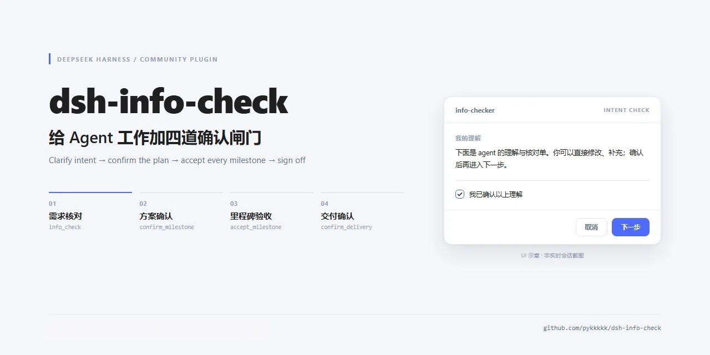
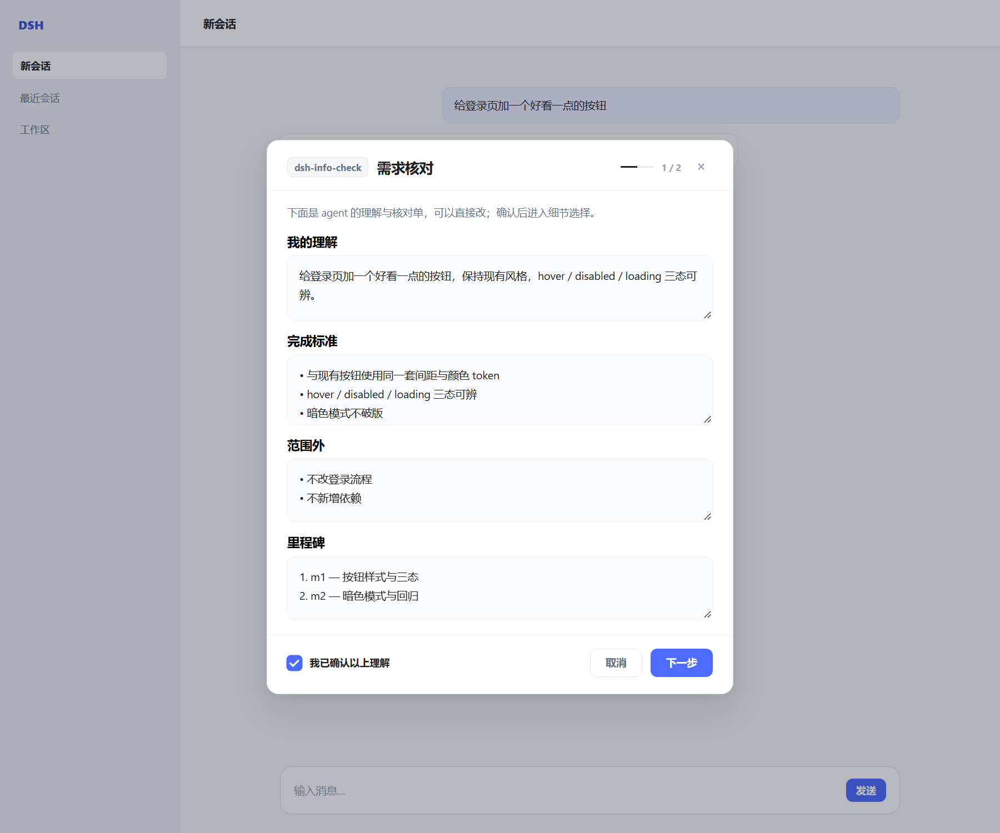
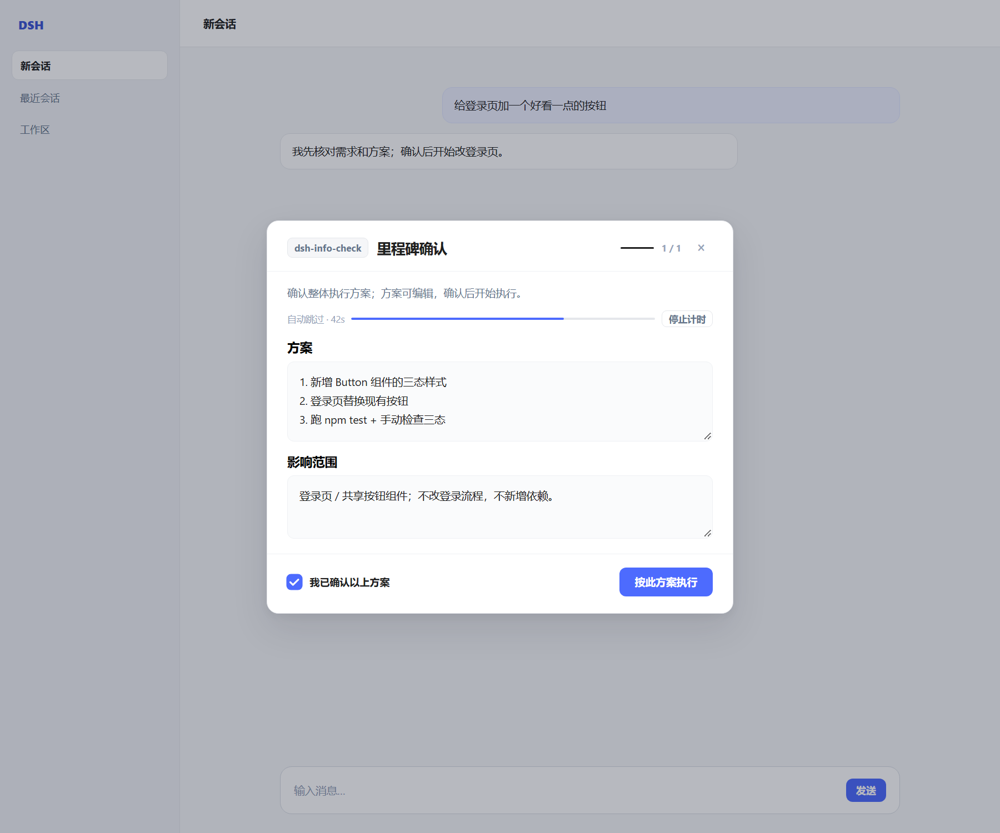
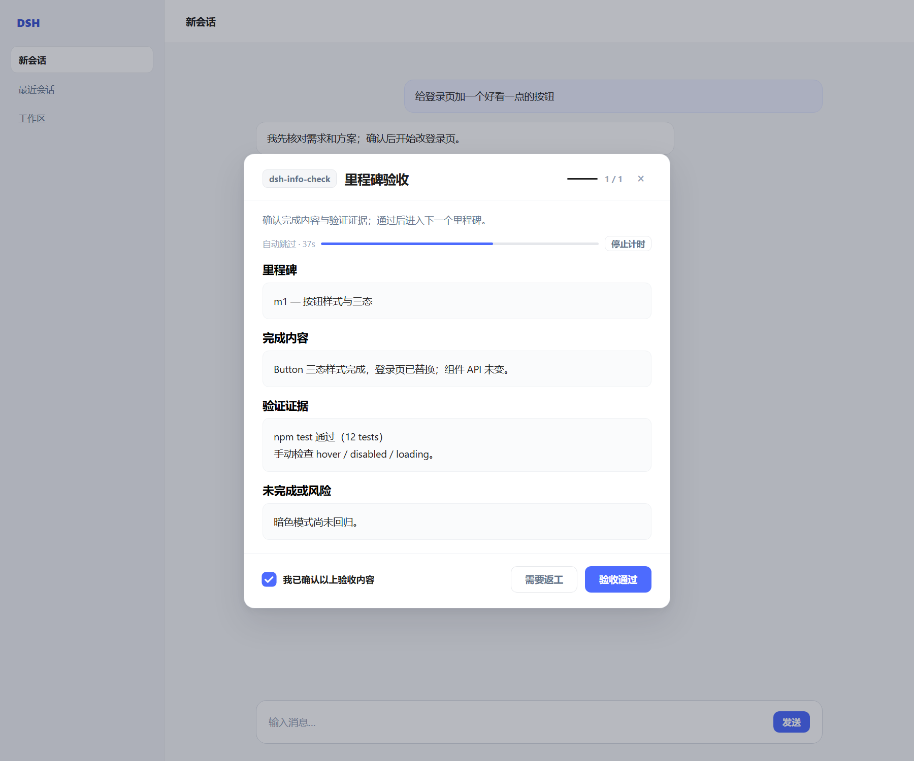
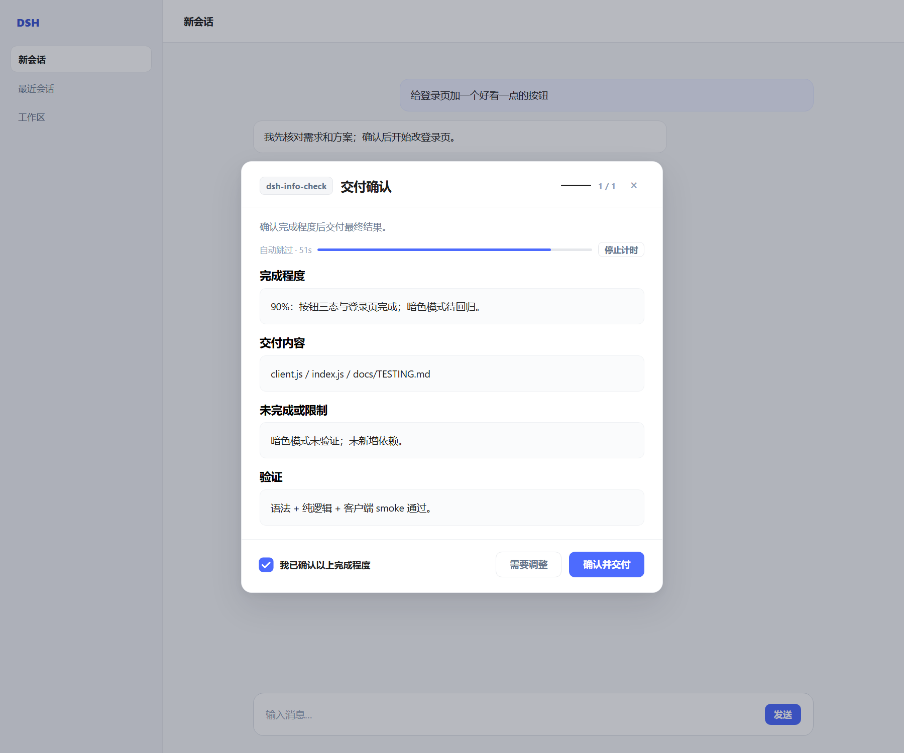
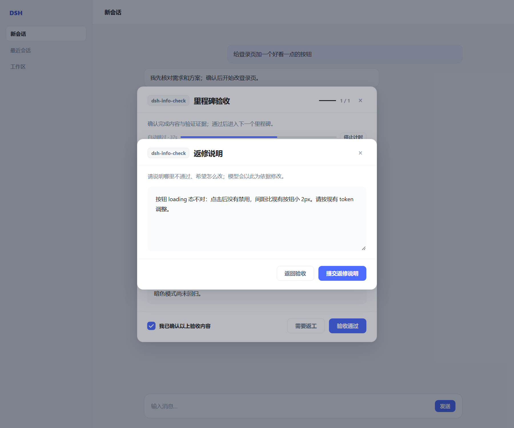
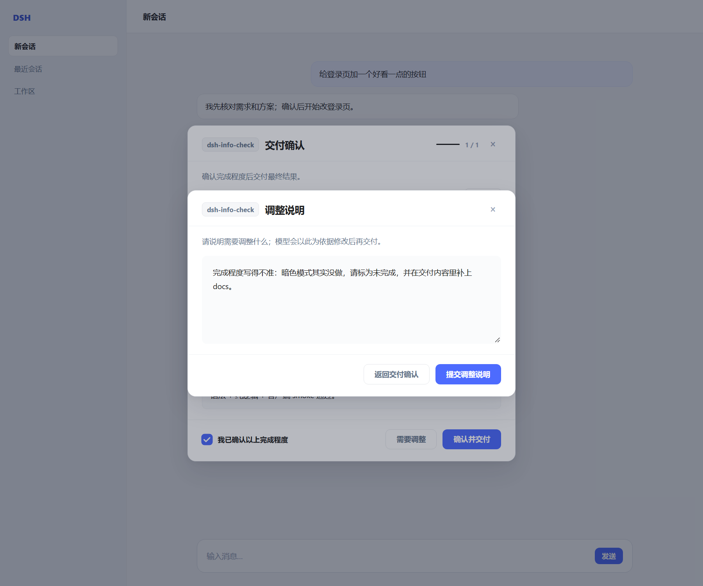
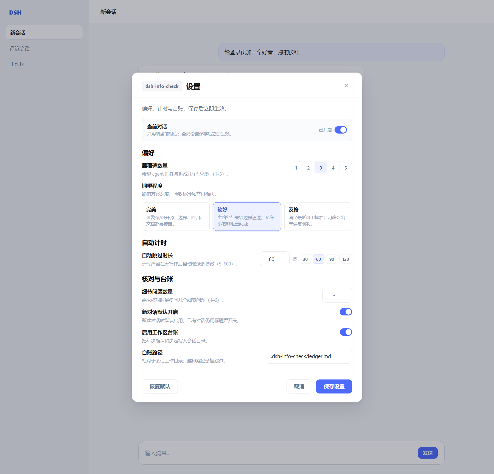

# dsh-info-check



[English](README.md) | 中文

仓库：<https://github.com/pykkkkk/dsh-info-check>

一个 [DeepSeek Harness](https://github.com/deepseek-ai/deepseek-harness) bundle，在 agent 的实质工作周围加一组**确认闸门**：先对齐需求，再确认一次方案，每个里程碑完成后验收，最终结果交付前再做一次完成度确认。

> 给 DSH 加一道“需求核对 → 方案确认 → 里程碑验收 → 交付确认”的闸门；每个对话独立开关，确认过程和选择会写入工作区台账。

## 状态

已在 **DSH `0.2.2-rc.3`**（Desktop profile，Windows）上测试。DSH 的插件 slot 与服务仍在演进；本 bundle 面向 `0.2.x` API，后续版本可能需要小调整。

这是一个独立的社区 bundle，不是 DeepSeek 官方包。

## 功能

| 闸门 | 工具 | 时机 |
|---|---|---|
| 需求核对 | `info_check` | 开始实质工作前：复述目标，问 2–3 个细节问题，确认完成标准 / 范围外 / 里程碑 |
| 方案确认 | `confirm_milestone` | 需求核对后**只一次**：确认整体执行方案（以第一个里程碑为主体） |
| 里程碑验收 | `accept_milestone` | **每个**里程碑完成后：只读完成报告；验收通过、返修，或暂停任务；可选结果文件打开所在位置 |
| 交付确认 | `confirm_delivery` | 最终结果呈现前：只读完成程度；确认交付，或填写调整说明 |

每次确认都是一个居中的浮窗：可编辑或只读的分段报告、确认复选框、主操作；三张计时浮窗还带倒计时（默认 60 秒）和 **“停止计时”**。点“需要返工 / 需要调整”会再打开一个 **“返修说明 / 调整说明”** 浮窗，理由作为 `feedback` 返回给模型。

浮窗可以**从右边缘拖动调宽**，最大宽度等于当前高度（并保持在视口的 75% 以内）。每个要点是独立文本框/只读框，左侧有单独的序号框（1、2、3…）；每张确认卡末尾都有 **备注** 输入栏。文本框会随内容自动增高。

细节选项支持再次点击取消，每个选项题下方有“其他”自由输入框。里程碑验收卡新增 **暂停任务**；可选 `files` 结果文件会显示为可点击路径，点击后在 Explorer 中打开文件所在位置。

详细设计与流程（中文）：[docs/DETAIL.md](docs/DETAIL.md)。界面说明：[docs/UI.md](docs/UI.md)。

## 截图

以下图片按插件**真实的浮窗 CSS** 在模拟对话背景上渲染，属于界面预览，不是某一次实时会话的截图。界面展示为中文；bundle 同时内置英文文案。

**社交预览图源文件：** [docs/social-preview.png](docs/social-preview.png)（1280×640，小于 1 MB）。

| 需求核对——可编辑核对单 | 里程碑确认——整个任务只一次 |
|---|---|
| [](docs/screenshots/01-intent-check.png) | [](docs/screenshots/02-plan-confirmation.png) |
| **里程碑验收——只读报告** | **交付确认——只读报告** |
| [](docs/screenshots/03-milestone-acceptance.png) | [](docs/screenshots/04-delivery-confirmation.png) |
| **返修说明——由“需要返工”打开** | **调整说明——由“需要调整”打开** |
| [](docs/screenshots/05-rework-notes.png) | [](docs/screenshots/06-adjustment-notes.png) |

**设置页**——偏好、自动计时、核对与台账、当前对话：

[](docs/screenshots/07-settings.png)

## 流程

```text
需求核对 -> 方案确认（一次） -> 里程碑 1
  -> 验收 1 -> 里程碑 2 -> 验收 2 -> ...
  -> 交付确认 -> 最终结果
```

## 安装

这是一个本地 DSH bundle（带 `dsh.bundle.patch` 的目录），没有发布到 npm。

1. 把本目录复制到运行 DSH 的机器。
2. 在 DSH 打开 **Plugins**，选择 **Add plugin**，指向本目录。  
   或者使用 plugin-manager：

   ```text
   plugin_manager install_bundle target=<本目录的绝对路径>
   ```

3. bundle 会注册一行 Host 插件（`include:dsh-info-check`）。客户端部分在下次刷新页面后加载。

要求：

- DSH `0.2.x`（以 `0.2.2-rc.3` 测试）。
- Host 需要提供 `tools`、`systemPrompt`、`userQuestions`、`workingDirectory`、`sessionProjections`、`commands`。
- Web 客户端需要 `react-dom` 的 `createPortal` 和 `remote.settings` 命名空间；没有 portal 时会退化为输入框内的卡片。

## 开关

**创造模式**（agent preset）旁边有一个小的 **需求核对** 开关：

- 新会话行：`conversation.hero.options`，在 preset 控件右侧。
- 会话内：`conversation.session.header.actions`，紧跟 preset 标签。

点下划线文字会打开插件设置浮窗；点开关只切换**当前对话**。切换会写成一条 `/dsh-info-check on|off` 命令，由 session projection 折叠，因此 fork/resume 会保留同一选择。

常用命令：

```text
/dsh-info-check status
/dsh-info-check on
/dsh-info-check off
```

## 设置

点击开关旁带下划线的 **需求核对** 文字，打开插件设置浮窗。它编辑全局 Config 并立即保存；窗口里的“当前对话”开关只影响本次会话。

- **偏好**：里程碑数量（1–5）、期望程度（完美 / 较好 / 及格）。这些值会进入策略、验收证据和交付确认。
- **自动计时**：自动跳过秒数（5–600；预设 30/60/90/120）。
- **核对与台账**：细节问题数量（1–6）、新对话默认开启、台账开关和路径。
- **当前对话**：不离开设置页即可切换本次会话的闸门。

这些字段都是 volatile Config，保存后无需重启插件即可生效。

## 计时与理由

- 计时闸门倒计时 `timeoutSeconds`（默认 60 秒）；超时继续（验收通过 / 交付继续）。
- **停止计时**会冻结倒计时并保留浮窗。
- 打开“返修说明 / 调整说明”也会停止计时。
- 验收与交付报告是**只读**的；用户输入的是理由，不是改报告。

## 台账

每次决定都会追加到：

```text
<会话工作目录>/.dsh-info-check/ledger.md
```

记录 agent 的报告、用户决定、编辑后的方案和返修说明。写入限制在会话目录内；越界路径会被跳过。`ledgerEnabled` / `ledgerPath` 可以调整。

## 配置

本 bundle 使用一个小型 **Config schema**（从 DSH 自带的 schemastery 加载，因此包本身仍没有 npm 依赖）。所有字段都是 volatile，通常直接在 **设置** 里改，而不是手改 patch：

| 字段 | 默认值 | 含义 |
|---|---|---|
| `milestoneCount` | `3` | 希望的里程碑数量（1–5） |
| `expectation` | `good` | `perfect` / `good` / `pass`；影响策略和验收标准 |
| `timeoutSeconds` | `60` | 方案/验收/交付三张计时卡的倒计时（5–600） |
| `maxQuestions` | `3` | 需求核对的细节问题数（1–6） |
| `defaultEnabled` | `true` | 尚无 `/dsh-info-check` 命令的对话的默认值 |
| `ledgerEnabled` | `true` | 是否追加工作区台账 |
| `ledgerPath` | `.dsh-info-check/ledger.md` | 台账路径，相对于会话目录 |

## 隐私

- 没有网络请求、遥测、分析或远程字体。
- 唯一的文件写入是会话目录下的台账。
- 用户的选择也会出现在会话日志里（命令与工具结果）。
- 这是 UX 闸门，不是安全边界：关闭或未确认时不会硬性阻止文件写入。

## 迁移与改名

当前本地包名是 `@local/dsh-info-check`（`private: true`）。如果要发布到自己的 scope/包名，需要同步修改：

1. `package.json` 的 `name`；
2. `client.js` 里 `__ModuleLoader__.load({ id: ... })`；
3. `cordis.patch.yml` 行的 `name`；
4. profile 里的 package/bundle 引用，然后重新安装。

客户端还依赖 DSH 特有的 slot 名（`conversation.composer`、`conversation.hero.options`、`conversation.session.header.actions`）和 `useProjection` / `remote.commands`。用 `engines.dsh` 固定测试过的 DSH 版本。

每个对话的开关使用一个极简 `{ parse }` schema 作为 `infoCheck` projection（以保持零依赖）。它按 DSH `0.2.2-rc.3` 验证；如果后续版本要求完整 schema 库，再加依赖并更新 `engines.dsh`。

## 限制

- 只支持根会话；子代理不能询问用户。
- 每次切换会在这个对话里留下一条 `/dsh-info-check` 命令行。
- 浮窗使用 DeepSeek Blue 浅色调；未做暗色适配。
- 新会话开关在 hero 行；发出第一条消息后由标题旁开关接手。
- 倒计时依赖 DSH 自带的问题卡实现；聚焦/编辑时会暂停。
- 台账是纯 Markdown，会随时间增长；需要时归档或轮换。

## 开发

没有依赖，不需要安装步骤：

```sh
npm run check   # 语法检查 Host、client、pure helpers
npm test        # 纯逻辑 + 客户端 smoke 测试
```

目录：

```text
index.js              Host 插件：策略、工具、projection、命令、台账
client.js             浏览器插件：浮窗、标题旁开关、设置页
lib/pure.js           校验、分段渲染、outcome、台账条目
test/                 只依赖 Node 的测试（不需要 DSH）
locale/               插件管理器展示元数据
docs/                 说明、UI 说明、手工测试计划、截图
cordis.patch.yml      bundle patch 行
icon.svg              原始图标
```

参见 [CONTRIBUTING.md](CONTRIBUTING.md) 和 [docs/TESTING.md](docs/TESTING.md)。发布前运行固定的[手动回归清单](docs/MANUAL-REGRESSION.md)。组件级浏览器 E2E 见 [docs/E2E.md](docs/E2E.md)。

## 许可证

MIT。Copyright (c) 2026 pykkkkk (Wenhao Liu)。见 [LICENSE](LICENSE)。

设计基线：DeepSeek Blue 单一强调色、克制的 8px 圆角、阅读优先布局。没有打包第三方代码或美术资源；图标为原创。
