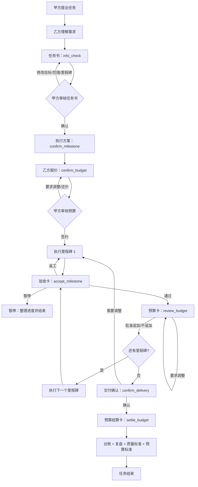

# 工程项目流程

dsh-info-check 把一次任务当成一份小型工程合同：

- **甲方**：用户，负责提出目标、审核任务书、批准预算、验收和结算。
- **乙方**：agent，负责理解需求、报价、执行、报告质量和成本。

## 完整流程

## 阶段说明

| 阶段 | 甲方 | 乙方 | 产出 |
|---|---|---|---|
| 任务书 | 提出目标，审核/修改 | 理解需求，提出任务书 | 目标、质量要求、范围外、里程碑 |
| 预算 | 审核、还价、签约 | 报价、分解、说明假设和风险 | 初始预算合同 |
| 执行/验收 | 验收当前里程碑 | 完成当前里程碑并提交证据 | 验收记录 |
| 预算审核 | 批准追加、不追加、调整或暂停 | 报告累计使用、本阶段使用、追加请求 | 阶段预算记录 |
| 交付 | 确认完成程度 | 汇总交付内容、限制和验证 | 交付确认 |
| 结算 | 评价预算是否合理 | 报告实际使用与差额 | 预算结算与预算标准 |

## 质量与成本

- **质量**：任务书定义完成标准；验收卡要求实际新增或修改的文件、验证证据和风险说明。
- **成本**：预算是有限的；初始报价必须分解；超额工作要提前申请追加，不能先做再补。
- **学习**：复盘沉淀质量标准；预算结算沉淀预算标准，用于后续报价参考。

## 状态约束

- 预算未签约，不能开始执行或验收。
- 里程碑验收后，预算审核完成前，不能进入下一个里程碑。
- 计划确认后，里程碑数量在任务结束前锁定。
- 每阶段只验收当前里程碑，不批量验收。
