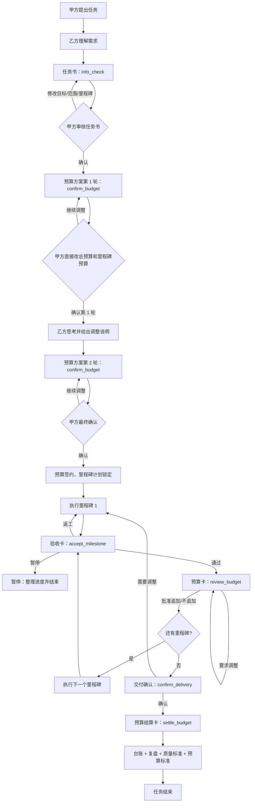

# 工程项目流程

dsh-info-check 把一次任务当成一份小型工程合同：

- **甲方**：用户，负责提出目标、审核任务书、修改预算、验收和结算。
- **乙方**：agent，负责理解需求、提出预算方案、执行、报告质量和成本。

## 完整流程

## 阶段说明

| 阶段 | 甲方 | 乙方 | 产出 |
|---|---|---|---|
| 任务书 | 提出目标，审核/修改 | 理解需求，提出任务书 | 目标、质量要求、范围外、里程碑 |
| 预算方案第 1 轮 | 直接修改总预算和每个里程碑预算 | 提出初始总预算和里程碑分配 | 预算方案草稿 |
| 预算方案第 2 轮 | 最终确认或继续修改 | 说明调整意见，重新提交 | 签约预算 |
| 执行/验收 | 验收当前里程碑 | 完成当前里程碑并提交证据 | 验收记录 |
| 预算审核 | 批准追加、不追加、调整或暂停 | 报告累计使用、本阶段使用、追加请求 | 阶段预算记录 |
| 交付 | 确认完成程度 | 汇总交付内容、限制和验证 | 交付确认 |
| 结算 | 评价预算是否合理 | 报告实际使用与差额 | 预算结算与预算标准 |

## 预算方案卡

- 第一个输入框是总预算，单位为人民币元（CNY），可直接修改。
- 每个里程碑行以 `m1`、`m2` 固定编号显示，内容输入框只填里程碑内容。
- 每个里程碑下面有带上下调的预算输入框，所有里程碑预算之和不能超过总预算。
- 总预算减去已分配金额后的剩余部分显示为**备用预算**。
- 不合法时直接显示行内错误，确认按钮不可用，不弹调整浮窗。
- 第 1 轮确认后，乙方必须思考并给出调整意见，第 2 轮由甲方再次确认后才签约。

## 预算使用卡

- 上方是只读的文本显示框，按行拆分为“文本 + 数据”两列。
- 下方先显示该里程碑的**初始预算**，再显示**累计已用**，方便同行对比。
- “是否追加预算？”是卡片内的选择题：不追加 / 追加；选择追加后才显示金额输入框。
- 数据来源优先读取 `@kenz1117/dsh-ui-usage-billing`；没有该插件时，从 DSH 会话日志的 token 用量估算。

## 质量与成本

- **质量**：任务书定义完成标准；验收卡要求实际新增或修改的文件、验证证据和风险说明。
- **成本**：预算是有限的；初始预算必须按里程碑分配；超额工作要提前申请追加，不能先做再补。
- **学习**：复盘沉淀质量标准；预算结算沉淀预算标准，用于后续报价参考。

## 状态约束

- 预算未签约，不能开始执行或验收。
- 里程碑验收后，预算审核完成前，不能进入下一个里程碑。
- 预算签约时锁定里程碑和预算；任务结束前不能增删。
- 每阶段只验收当前里程碑，不批量验收。
